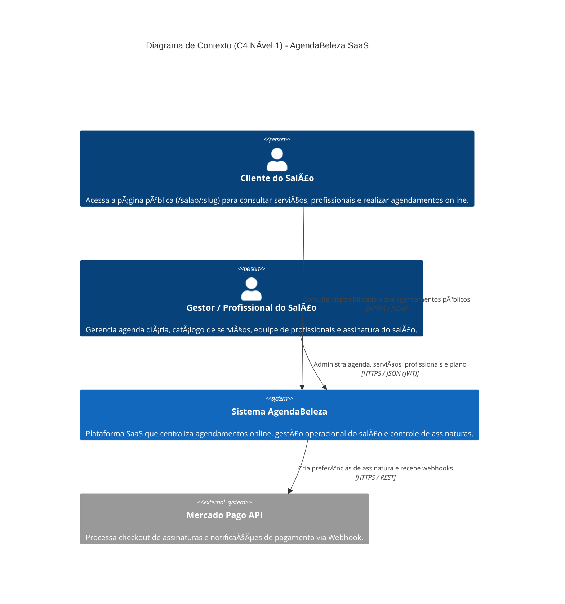
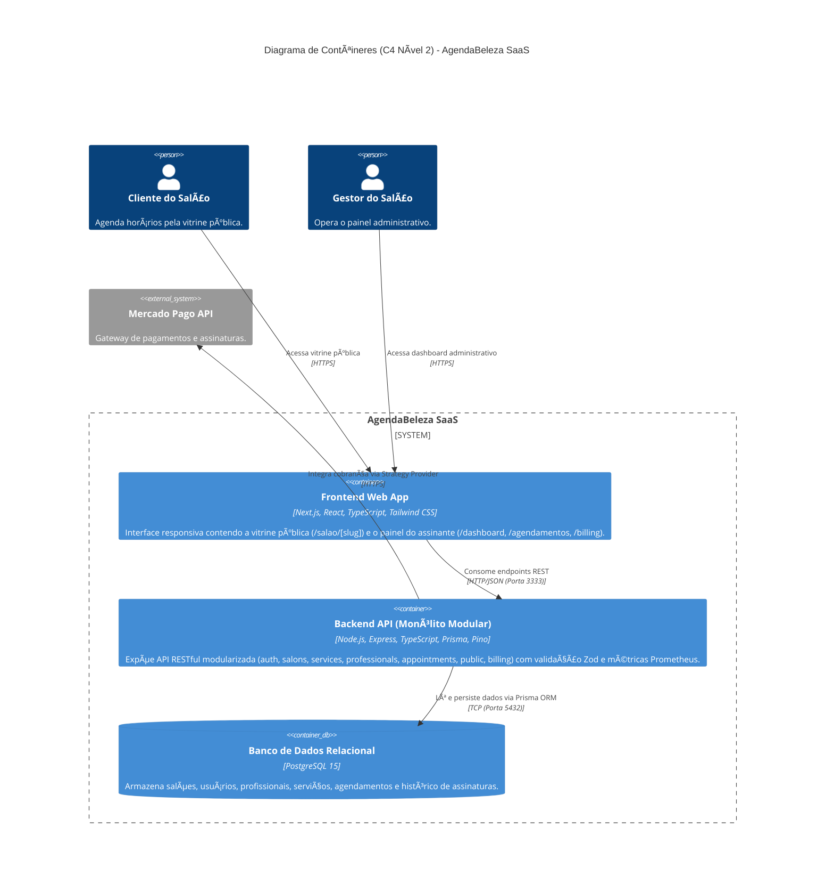

# Arquitetura C4 — AgendaBeleza (Contexto e Contêineres)

Diagramas elaborados em **Mermaid C4** representando as fronteiras do sistema **AgendaBeleza** e seus contêineres de execução.

## Nível 1: Diagrama de Contexto do Sistema (C4 Context)

## Nível 2: Diagrama de Contêineres (C4 Container)

